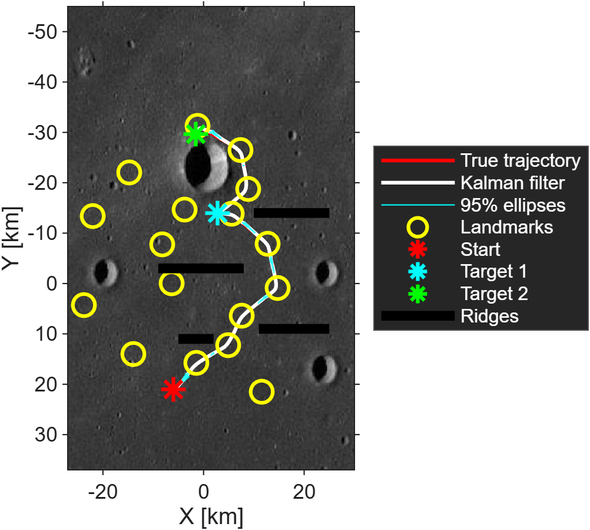
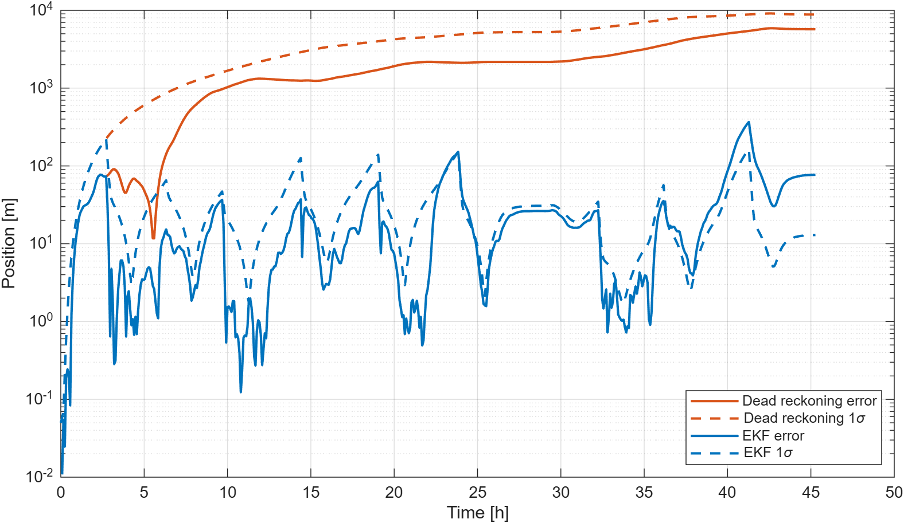
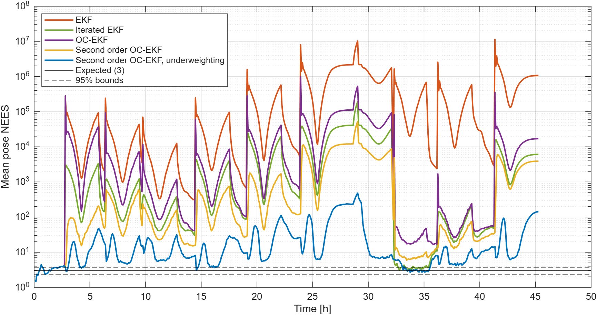

# Lunar rover localisation

Path planning, control and onboard localisation of a simulated lunar rover, in MATLAB.
A rover has to drive about 76 km across a lunar region, between craters and ridges, to two targets, and know where it is along the way.

The problem comes from the final exercise of the Space Robotic Systems course at Sapienza University of Rome (2020/2021).
This repository is a rewrite from scratch of my original solution: it fixes several errors of the 2021 code and shows that the standard extended Kalman filter is badly overconfident on this problem, and how to make it consistent.

<p align="center">
  
</p>

## The problem

The rover is a kinematic bicycle with a 1 m wheelbase and a maximum speed of 2 km/h (like the Lunokhod rovers).
It starts at (−6, 21) km with heading 0.41 rad and has to reach target 1 at (2.8, −14) km and then target 2 at (−1.6, −29.7) km, avoiding a large crater and four ridges.

1. **Planning and control.** Design a safe path to both targets and drive the rover along it.
2. **Dead reckoning.** Taking the driven path as the truth, reconstruct it onboard from the odometer only, with noise of 3 cm on the travelled distance and 0.8° on the heading, starting from a covariance of 5 cm and 0.001°.
3. **Kalman filter.** Reconstruct it again fusing the odometer with a lidar terrain mapper that measures range and bearing (2 cm and 0.3° noise) to 17 known landmarks within 3 km. The reconstructed path and its uncertainty ellipses must avoid craters and ridges.

## Running it

Requires base MATLAB only (no toolboxes). Tested with R2026a.

```matlab
main          % the three tasks: figures in results/figures, numbers in results/summary.txt
monte_carlo   % consistency of five filters over 50 noise realisations (results/monte_carlo.txt)
```

All problem data and tuning parameters are in [`src/rover_parameters.m`](src/rover_parameters.m).

| File | Content |
|---|---|
| `main.m` | Runs the three tasks |
| `monte_carlo.m` | Filter consistency analysis (NEES) |
| `src/rover_parameters.m` | Problem data, planning, control and filter settings |
| `src/plan_leg.m`, `src/lspb_via_points.m` | Reference path: linear segments with parabolic blends through via points |
| `src/rover_controller.m`, `src/simulate_drive.m` | Moving target follower and move to a point control, ode45 integration |
| `src/simulate_odometry.m`, `src/odometry_step.m` | Noisy odometer readings and pose/covariance propagation |
| `src/dead_reckoning.m` | Task 2 |
| `src/lidar_measurement.m`, `src/ekf_localisation.m` | Task 3: EKF, iterated EKF, observability constrained and second order variants |
| `src/plot_results.m` | Figures |

## Results

| | |
|---|---|
| Arrival at target 1 / target 2 | 28.6 h / 45.3 h (with a 0.5 h stop at target 1) |
| Path length | 75.9 km, at least 2.5 km from every ridge |
| Dead reckoning, final error | 5.7 km; the 95% ellipses cross the crater and the ridges |
| Kalman filter, RMS error (50 runs) | 51 m; path and 95% ellipses at least 2.4 km from every ridge |

Odometry alone is not safe over tens of kilometres: the error grows without bound.
With lidar updates the uncertainty grows only on the stretches without landmarks and collapses at the next measurement.



## Filter consistency

An uncertainty ellipse is only useful for hazard avoidance if it is honest.
The standard EKF is not: at each lidar measurement its uncertainty collapses to about a metre while the real error stays tens of metres.
Two effects add up.

- **Unobservability.** The lidar never sees two landmarks at once (along this path, 423 samples with one landmark in range, 144 with none, never two).
  Rotating the whole pose about the visible landmark leaves range and bearing unchanged, and the odometer only measures relative motion, so that direction is unobservable.
  The standard EKF evaluates the propagation and measurement Jacobians at different estimates and gains spurious information along it.
  The **observability constrained EKF** builds the propagation Jacobian from the predicted poses, so that the unobservable direction is preserved; for range and bearing to a known landmark, the measurement Jacobian at the predicted pose already satisfies the constraint.
- **Nonlinearity.** After a stretch without landmarks the position is uncertain by hundreds of metres, while the range is accurate to 2 cm.
  Over that spread the range is metres away from its linearisation (about e²/2r).
  A **second order filter** adds the curvature of the measurement model to the predicted measurement and its covariance, and **measurement underweighting** scales H P Hᵀ in the gain so that the first measurement after a gap is not trusted too much.

Mean normalised estimation error squared (NEES) of the pose over 50 Monte Carlo runs; a consistent filter has a mean of 3 (95% bounds 2.36 to 3.72):

| Filter | Mean NEES | Median NEES | Errors inside the 95% ellipse | RMS position error |
|---|---:|---:|---:|---:|
| EKF | 449 301 | 1841 | 14.0% | 179.1 m |
| Iterated EKF | 6 466 | 33.6 | 32.6% | 69.7 m |
| Observability constrained EKF | 21 371 | 64.6 | 32.8% | 82.0 m |
| Second order OC-EKF | 1 925 | 5.07 | 59.2% | 56.6 m |
| Second order OC-EKF, underweighting (default) | 32.9 | 3.00 | 78.2% | 50.8 m |



The default filter is consistent most of the time; the remaining outliers come right after the longest stretches without landmarks, where the true uncertainty is a thin arc around the landmark that no Gaussian describes well.

## References

- J. J. Craig, *Introduction to Robotics: Mechanics and Control*, Pearson (trajectories with parabolic blends).
- P. Corke, *Robotics, Vision and Control*, Springer (rover control and localisation).
- G. P. Huang, A. I. Mourikis, S. I. Roumeliotis, "Observability-based rules for designing consistent EKF SLAM estimators", *International Journal of Robotics Research*, 29(5), 2010.
- Y. Bar-Shalom, X. R. Li, T. Kirubarajan, *Estimation with Applications to Tracking and Navigation*, Wiley, 2001 (second order filter, NEES).
- R. Zanetti, "Recursive update filtering for nonlinear estimation", *IEEE Transactions on Automatic Control*, 57(6), 2012 (measurement underweighting).

## Author

Francesco Mazzei · [framazzei3.github.io](https://framazzei3.github.io)
